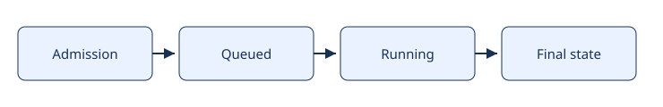
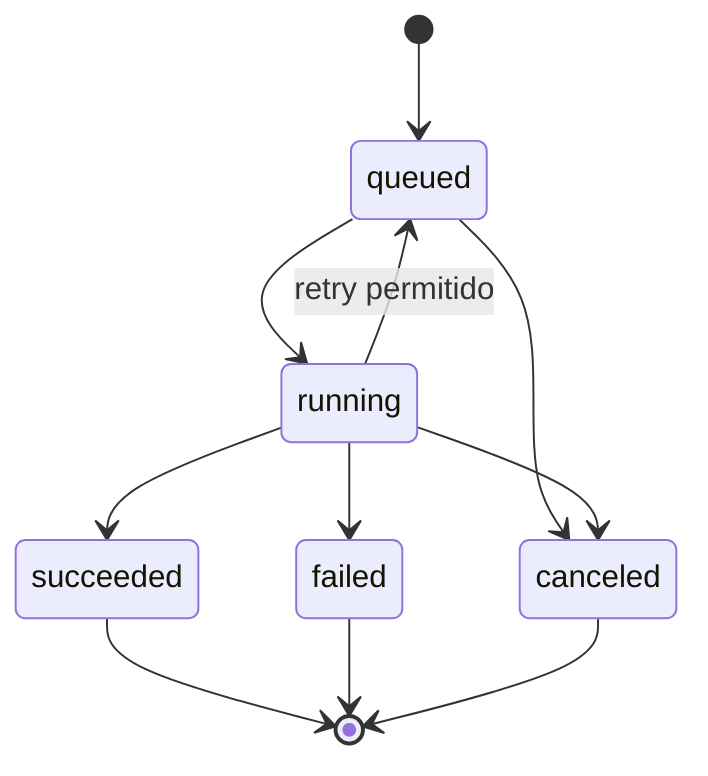

# Proyecto final · Procesador concurrente de trabajos

[Inicio](../README.md) · [Roadmap](../ROADMAP.md) · [Última lección](../modules/06-backend/08-service-tests.md)

Tú construyes el sistema. Este directorio contiene especificaciones y escenarios, no implementación ni tests que escondan una solución. Crea tus packages, pruebas y documentación conforme completes los hitos. Primero define contratos, después el flujo más sencillo, y solo entonces concurrencia.



## Objetivo y límites

Registrar tareas por HTTP, conservar una cola acotada en memoria y procesarlas con un worker pool configurable. Una tarea de laboratorio recibe un texto UTF-8 válido de hasta 4096 bytes y calcula su cantidad de runes. El procesamiento debe aceptar ctx; en tests podrás inyectar una operación controlada que falle o espere cancelación para investigar reintentos sin añadir retrasos artificiales a la tarea real.

La persistencia es volátil: reiniciar pierde registros y cola. Este sistema no garantiza exactamente una vez ni distribución entre procesos. No uses Redis, frameworks HTTP ni drivers de DB en la versión principal. La autenticación, multi-tenant y despliegue productivo quedan fuera del ejercicio.

## Contrato observable

| Operación | Entrada | Resultado |
| --- | --- | --- |
| POST /jobs | JSON con text string | 202 con id único y estado queued; 400 inválido; 413 body >8192 bytes; 503 saturación o admisión cerrada. |
| GET /jobs/{id} | ID devuelto al registrar | 200 snapshot; 404 desconocido. |
| POST /jobs/{id}/cancel | ID existente | 202 solicitud aceptada si no es terminal; 409 si terminal; 404 desconocido. |

Snapshots incluyen id, state, attempts, result (cantidad de runes solo en éxito) y error externo seguro cuando corresponda. No exponen un pointer/map mutable interno. Los timestamps son opcionales y no se requieren para tests. IDs no se reutilizan durante la vida del proceso.

Estados: queued → running → succeeded o failed; running → queued si corresponde un retry; queued/running → canceled por cancelación aceptada. Estados terminales no cambian. La aceptación de cancelación puede competir con finalización: documenta y prueba un punto de decisión serializado; si finalización ya ganó devuelve 409, si cancelación ganó no publiques después succeeded. No existe rollback de efectos externos.

Configuración: workers >=1, queue capacity >=1, max attempts >=1, timeout por intento >0, backoff inicial >0 y presupuesto shutdown >0. Defaults de laboratorio: 2 workers, capacidad 8, 3 intentos totales, 1 segundo por intento, backoff 100ms duplicado por reintento con límite 1 segundo, shutdown 5 segundos. Valida antes de empezar a servir.

El body debe ser un único JSON; rechaza campos desconocidos. Text requerido, permite string vacío (resultado 0). La admisión llena rechaza de inmediato: no crees goroutines esperando indefinidamente para registrar. Cada job aceptado tiene un registro visible aunque todavía espere en cola.

## Máquina de estados visual

```text
queued → running → succeeded
   |         ├──→ failed
   |         ├──→ queued (retry permitido)
   └─────────┴──→ canceled (cancelación gana decisión)
```



El retry cuenta un intento nuevo y vuelve a admitir trabajo sin superponer ejecuciones del mismo job. El diagrama no determina una estructura de código: tú decides y justificas cómo serializar transiciones.

## Recorrido

1. [Contrato y diseño](01-contract.md)
2. [Ejecución secuencial](02-sequential.md)
3. [Cola y pool](03-pool.md)
4. [API HTTP](04-http.md)
5. [Resiliencia y cancelación](05-resilience.md)
6. [Graceful shutdown](06-shutdown.md)
7. [Pruebas y medición](07-verification.md)
8. [Docker opcional](08-docker.md)

## Extensiones distribuidas

Tras cerrar la versión local, escribe distributed-notes.md: ¿qué ocurre si un worker muere tras aplicar un efecto pero antes de confirmar? Una cola durable puede entregar otra vez; idempotencia debe estar asociada a una operación y clave definidas. Reintentar no implica exactamente una vez. Considera leases, recuperación de trabajo, almacenamiento de estados, deduplicación y observabilidad de fallos parciales. Son preguntas para diseñar una extensión, no requisitos implementados por este libro.

Marca avance en [PROGRESS](../PROGRESS.md) solo con tu evidencia.
