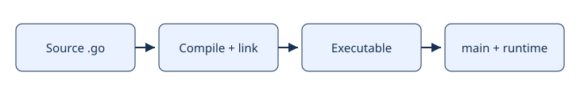

# 02 · Compilador, binario y runtime

[Índice del módulo](README.md) · [Roadmap](../../ROADMAP.md) · Anterior: [Filosofía e historia](01-philosophy.md) · Siguiente: [Estructura de un programa](03-program.md)

## Objetivos de aprendizaje

- Explicar compilador, binario y runtime y el problema que resuelve.
- Predecir el comportamiento del ejemplo, incluyendo sus límites.
- Aplicar el contrato del ejercicio y justificar una decisión sin copiar el ejemplo.

## Conocimientos previos

Estudia [Filosofía e historia](01-philosophy.md) antes. El recorrido es acumulativo: usa el [glosario](../../GLOSSARY.md) si un término de módulos anteriores no está claro. Para comprobar el entorno consulta [setup](../../docs/setup.md).

## Motivación

Quieres distribuir una herramienta sin instalar el SDK en cada máquina y distinguir el coste de construir del de ejecutar.

## Explicación conceptual

El compilador comprueba tipos y traduce paquetes; el linker combina sus resultados, dependencias y partes necesarias del runtime en un ejecutable. El comando `go` orquesta estas operaciones y utiliza caches: repetir un build no implica recompilarlo todo.

`go run` construye y ejecuta un programa temporal. `go build` construye, pero no ejecuta; con `-o` decides la salida. En paquetes que no son `main`, build comprueba y prepara artefactos, sin producir una aplicación ejecutable independiente. Una aplicación requiere `package main` y `func main()`.

El runtime trabaja durante la ejecución: administra goroutines, memoria y otras funciones del lenguaje. El compilador decide instrucciones y optimizaciones antes de esa ejecución. No dibujes «compilador dentro del binario» para explicar Go: son responsabilidades distintas.

`GOOS` y `GOARCH` describen destino; `go env` muestra los valores efectivos. Un binario Linux/amd64 no se vuelve portable a Windows por contener el runtime. En programas con cgo puede haber dependencias dinámicas; no prometas que todos los binarios Go son estáticos. Mantén el ejemplo sin dependencias externas para observar primero el camino sencillo.

### Traza de responsabilidades

| Momento | Acción | Qué no demuestra |
| --- | --- | --- |
| Build | Comprueba y enlaza un ejecutable. | Que las rutas de negocio produzcan resultados correctos. |
| Arranque | Inicializa runtime/packages e invoca main. | Que todos los goroutines futuros vayan a terminar. |
| Ejecución | Procesa datos y coordina recursos. | Que un binario sea compatible con cualquier OS. |

Cambiar código después de construir no cambia el ejecutable ya creado. Para observar el cambio debes reconstruir; ejecutar un binario antiguo puede explicar una salida que parece ignorar tu edición.

## Modelo mental visual



```text
source .go → type checking → object code → linker → executable
                                                       |
                                                       v
                                             main + Go runtime
```

El diagrama representa relaciones y decisiones observables, no direcciones reales ni un ABI garantizado. Predice un cambio y dibuja qué parte del modelo cambia.

## Sintaxis y ejemplos

[Programa completo](examples/02-compilation/main.go):

```go
package main

import (
	"fmt"
	"runtime"
)

func main() { fmt.Printf("%s/%s\n", runtime.GOOS, runtime.GOARCH) }
```

Desde la raíz:

```sh
go run ./modules/01-fundamentals/examples/02-compilation
go build -o /tmp/go-from-zero-example ./modules/01-fundamentals/examples/02-compilation
```

**Resultado e interpretación:** En este entorno imprime `linux/amd64`. En otro sistema puede variar; la propiedad a comprobar es que refleja el destino del binario.

Antes de ejecutarlo, anota tu predicción. Después señala qué instrucción explica cada resultado y qué propiedad no demuestra esta ejecución.

## Comparación con otros lenguajes

`tsc` suele emitir JavaScript, que después ejecuta un motor. `javac` emite bytecode. `go build` para un main produce un binario nativo; ese contraste no implica superioridad universal.

## Errores comunes

Intentar ejecutar un binario de otro OS; medir go run como si midiera solo ejecución; asumir que build ejecuta main.

Si observas un fallo, conserva el mensaje exacto y una hipótesis. Compilar y ejecutar son verificaciones diferentes; no arregles por ensayo ciego.

## Ejercicio guiado

Crea manualmente `main.go`, package main, que imprima `build experiment`. Entrada: ninguna. Salida exacta: esa línea con salto final. Ejecuta con go run, construye en /tmp y ejecuta el binario. Aceptación: ambas salidas iguales y explica qué archivo sobrevivió a cada comando.

[Enunciado y espacio de implementación](exercises/02-compilation/guided/README.md) · [Pistas progresivas](exercises/02-compilation/guided/HINTS.md). Escribe tú la implementación; no hay solución preparada.

## Desafío independiente

Escribe `build-notes.md`: entrada, un binario construido; salida, qué pasaría al borrar el source sin borrar el binario y qué pasaría en otra arquitectura. No necesitas borrar nada. Aceptación: separar hipótesis de observación y mencionar enlace dinámico.

[Enunciado y espacio](exercises/02-compilation/challenge/README.md) · [Pistas opcionales](exercises/02-compilation/challenge/HINTS.md). Resuelve primero sin abrir pistas.

## Preguntas de comprensión

1. ¿Por qué go run tiene latencia antes de main?
2. ¿El binario necesita el compilador?

[Respuestas razonadas](self-assessment/02-compilation.md): consulta después de responder y explica en tus palabras cualquier diferencia. No contienen soluciones de ejercicios.

## Resumen y referencias

Quieres distribuir una herramienta sin instalar el SDK en cada máquina y distinguir el coste de construir del de ejecutar. El criterio de comprensión es explicar el mecanismo, predecir el ejemplo y justificar sus límites.

[Go command](https://pkg.go.dev/cmd/go) · [Runtime](https://pkg.go.dev/runtime)

[Compatibilidad y fuentes](../../docs/sources.md) · [Registrar evidencia](../../PROGRESS.md)
