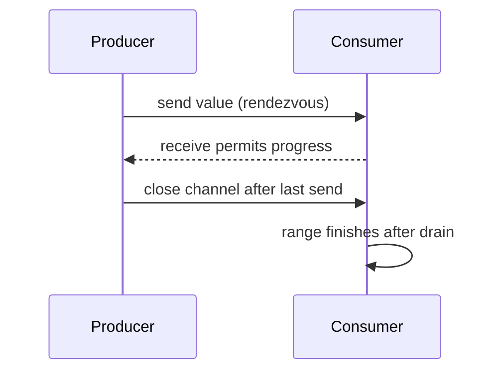

# 03 · Channels

[Índice del módulo](README.md) · [Roadmap](../../ROADMAP.md) · Anterior: [Goroutines y scheduler](02-goroutines.md) · Siguiente: [Select](04-select.md)

## Objetivos de aprendizaje

- Explicar channels y el problema que resuelve.
- Predecir el comportamiento del ejemplo, incluyendo sus límites.
- Aplicar el contrato del ejercicio y justificar una decisión sin copiar el ejemplo.

## Conocimientos previos

Estudia [Goroutines y scheduler](02-goroutines.md) antes. El recorrido es acumulativo: usa el [glosario](../../GLOSSARY.md) si un término de módulos anteriores no está claro. Para comprobar el entorno consulta [setup](../../docs/setup.md).

## Motivación

Necesitas transferir resultados y establecer coordinación, no solo compartir variables esperando que el otro las lea.

## Explicación conceptual

Un channel tiene tipo de elemento y capacidad. Uno sin buffer necesita que envío y recepción se encuentren; el envío puede bloquear hasta que hay receptor. Uno con buffer admite envíos hasta llenar su capacidad y recepciones hasta vaciarlo. Capacidad limita el buffer, no toda memoria o todo trabajo del sistema.

Enviar a channel nil y recibir de él bloquea indefinidamente; un channel nil puede servir para desactivar un case de select. Close indica que no habrá más envíos. Recibir de un channel cerrado entrega elementos pendientes y luego zero value con ok=false. Enviar a cerrado o cerrarlo dos veces causa panic.

Normalmente el productor o coordinador que conoce el fin de todos los productores cierra. El consumidor no debe cerrar solo porque ya no quiere datos: otro envío podría fallar. Comunica cancelación por separado. `range ch` termina al cerrarse y drenar; si nadie cierra puede bloquear para siempre.

Channel no hace inmutable el objeto enviado. Si envías un slice y sigues modificando sus elementos, puede haber datos compartidos. Define transferencia de propiedad o copia. Sincronización establece visibilidad, no te obliga a una política de negocio correcta.

## Modelo mental visual

```text
producer ── send ──> [buffer] ── receive ──> consumer
close: no more sends; drain → zero,false
```

Mermaid complementario (el esquema ASCII anterior contiene la misma coordinación esencial):



El diagrama representa relaciones y decisiones observables, no direcciones reales ni un ABI garantizado. Predice un cambio y dibuja qué parte del modelo cambia.

## Sintaxis y ejemplos

[Programa completo](examples/03-channels/main.go):

```go
package main

import "fmt"

func main() {
	ch := make(chan string, 2)
	ch <- "north"
	ch <- "south"
	close(ch)
	for item := range ch {
		fmt.Println(item)
	}
	v, ok := <-ch
	fmt.Printf("%q %v\n", v, ok)
}
```

Desde la raíz:

```sh
go run ./modules/05-concurrency/examples/03-channels
go build -o /tmp/go-from-zero-example ./modules/05-concurrency/examples/03-channels
```

**Resultado e interpretación:** Imprime north, south y después `"" false`. El buffer conserva orden de los envíos de este único productor.

Antes de ejecutarlo, anota tu predicción. Después señala qué instrucción explica cada resultado y qué propiedad no demuestra esta ejecución.

## Comparación con otros lenguajes

No equivale a una cola durable de Redis ni a un EventEmitter; coordina goroutines del proceso y pierde datos al terminar.

## Errores comunes

Close desde receptor sin coordinación; channel=nil para resolver un leak ya existente; enviar pointer y asumir exclusividad.

Si observas un fallo, conserva el mensaje exacto y una hipótesis. Compilar y ejecutar son verificaciones diferentes; no arregles por ensayo ciego.

## Ejercicio guiado

Implementa productor de números 1..4 y consumidor que sume. Entrada: límite 4. Salida:10. Restricción: productor cierra, consumidor range, sin sleeps. Aceptación: proceso termina y canal se cierra una vez.

[Enunciado y espacio de implementación](exercises/03-channels/guided/README.md) · [Pistas progresivas](exercises/03-channels/guided/HINTS.md). Escribe tú la implementación; no hay solución preparada.

## Desafío independiente

Construye una transferencia de []int donde el productor deja de mutar tras enviar. Entrada:[3,4]. Salida: consumidor puede transformar sin acceso concurrente. Aceptación: documentar ownership y verificar -race.

[Enunciado y espacio](exercises/03-channels/challenge/README.md) · [Pistas opcionales](exercises/03-channels/challenge/HINTS.md). Resuelve primero sin abrir pistas.

## Preguntas de comprensión

1. ¿Por qué bloquea un channel sin buffer?
2. ¿Close significa que la recepción falla de inmediato?

[Respuestas razonadas](self-assessment/03-channels.md): consulta después de responder y explica en tus palabras cualquier diferencia. No contienen soluciones de ejercicios.

## Resumen y referencias

Necesitas transferir resultados y establecer coordinación, no solo compartir variables esperando que el otro las lea. El criterio de comprensión es explicar el mecanismo, predecir el ejemplo y justificar sus límites.

[Channels](https://go.dev/ref/spec#Channel_types) · [Pipelines](https://go.dev/blog/pipelines)

[Compatibilidad y fuentes](../../docs/sources.md) · [Registrar evidencia](../../PROGRESS.md)
