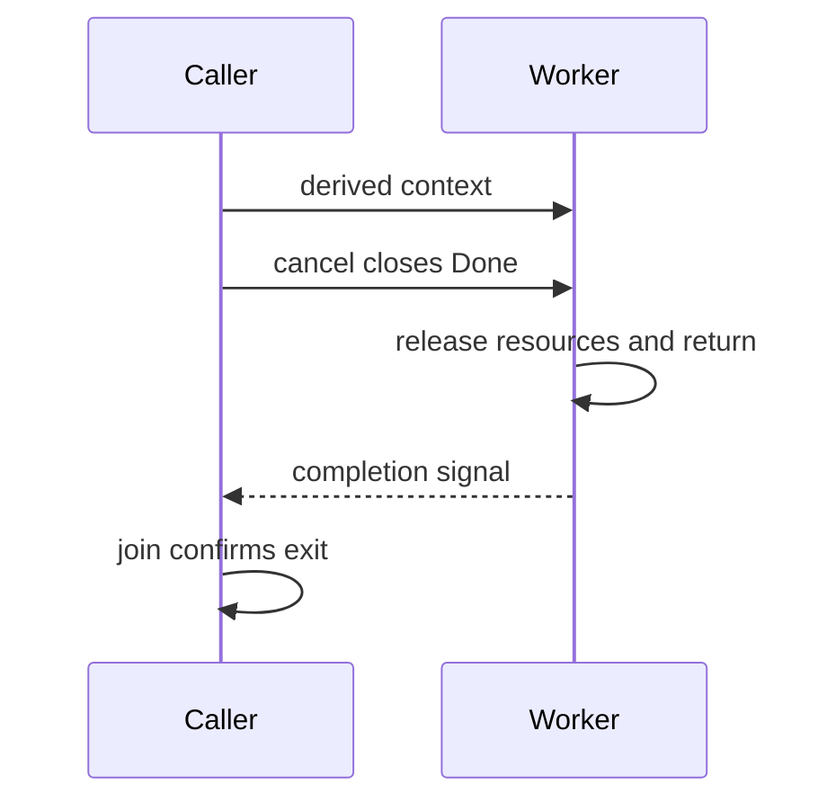

# 08 · Context y cancelación

[Índice del módulo](README.md) · [Roadmap](../../ROADMAP.md) · Anterior: [Carreras, deadlocks y leaks](07-failures.md) · Siguiente: [Worker pools y shutdown](09-workers.md)

## Objetivos de aprendizaje

- Explicar context y cancelación y el problema que resuelve.
- Predecir el comportamiento del ejemplo, incluyendo sus límites.
- Aplicar el contrato del ejercicio y justificar una decisión sin copiar el ejemplo.

## Conocimientos previos

Estudia [Carreras, deadlocks y leaks](07-failures.md) antes. El recorrido es acumulativo: usa el [glosario](../../GLOSSARY.md) si un término de módulos anteriores no está claro. Para comprobar el entorno consulta [setup](../../docs/setup.md).

## Motivación

Cancelación y plazos deben cruzar llamadas sin inventar un protocolo distinto por cada función.

## Explicación conceptual

Context transporta deadline, señal de cancelación y valores acotados al request. Pásalo como primer parámetro ctx; evita almacenarlo en structs de larga vida o usarlo como una bolsa de configuración. Background es una raíz; derivados heredan cancelación.

WithCancel, WithTimeout y WithDeadline devuelven un contexto y una función cancel. Llama cancel para liberar recursos aunque el trabajo termine antes del plazo. Done se cierra al cancelar; Err distingue Canceled y DeadlineExceeded. No existe una operación que mate una goroutine arbitraria: la actividad debe escuchar o llamar APIs que respeten ctx.

Value se reserva para datos del scope de request como identidad o correlación, con claves tipadas privadas para evitar colisiones. No uses Value para pasar dependencias obligatorias que podrían ser parámetros explícitos.

Cancelar pide terminar, no demuestra que terminó. El caller debe esperar workers o cierre de resultados. Usa timers detenidos cuando dejas de necesitarlos. Si una operación externa ignora ctx, poner un select alrededor puede dejar trabajo vivo; diseña límites en el propio cliente o dependencia.

## Modelo mental visual

```text
parent context
  └─ child timeout/cancel → Done closes
                               ↓
                       cooperative work exits
caller join confirms exit
```

Mermaid complementario (el esquema ASCII anterior contiene la misma coordinación esencial):



El diagrama representa relaciones y decisiones observables, no direcciones reales ni un ABI garantizado. Predice un cambio y dibuja qué parte del modelo cambia.

## Sintaxis y ejemplos

[Programa completo](examples/08-context/main.go):

```go
package main

import (
	"context"
	"fmt"
)

func main() {
	ctx, cancel := context.WithCancel(context.Background())
	done := make(chan error)
	go func() { <-ctx.Done(); done <- ctx.Err() }()
	cancel()
	fmt.Println(<-done)
}
```

Desde la raíz:

```sh
go run ./modules/05-concurrency/examples/08-context
go build -o /tmp/go-from-zero-example ./modules/05-concurrency/examples/08-context
```

**Resultado e interpretación:** Imprime `context canceled`. main no se limita a cancelar: espera la confirmación del worker.

Antes de ejecutarlo, anota tu predicción. Después señala qué instrucción explica cada resultado y qué propiedad no demuestra esta ejecución.

## Comparación con otros lenguajes

AbortSignal en Node.js también requiere soporte de la operación. Interrumpir en Java tiene condiciones propias; no supongas terminación forzosa.

## Errores comunes

Context en struct global; olvidar cancel; valores para dependencias; timeout que deja goroutine viva.

Si observas un fallo, conserva el mensaje exacto y una hipótesis. Compilar y ejecutar son verificaciones diferentes; no arregles por ensayo ciego.

## Ejercicio guiado

Implementa `Wait(ctx context.Context) error` que retorne al cancelarse. Entrada:ctx cancelado. Salida:context.Canceled. Restricción: sin sleeps ni goroutine interna necesaria. Aceptación: errors.Is y retorno inmediato tras señal.

[Enunciado y espacio de implementación](exercises/08-context/guided/README.md) · [Pistas progresivas](exercises/08-context/guided/HINTS.md). Escribe tú la implementación; no hay solución preparada.

## Desafío independiente

Implementa envío cancelable `Send(ctx context.Context,ch chan<- int,n int) error`. Entrada:canal sin receptor y ctx cancelado. Salida:error de cancelación. Aceptación: no quedar bloqueado y documentar que si envío y cancelación están listos puede ganar cualquiera.

[Enunciado y espacio](exercises/08-context/challenge/README.md) · [Pistas opcionales](exercises/08-context/challenge/HINTS.md). Resuelve primero sin abrir pistas.

## Preguntas de comprensión

1. ¿Cancel mata una goroutine?
2. ¿Por qué esperar después de cancel?

[Respuestas razonadas](self-assessment/08-context.md): consulta después de responder y explica en tus palabras cualquier diferencia. No contienen soluciones de ejercicios.

## Resumen y referencias

Cancelación y plazos deben cruzar llamadas sin inventar un protocolo distinto por cada función. El criterio de comprensión es explicar el mecanismo, predecir el ejemplo y justificar sus límites.

[Context](https://pkg.go.dev/context)

[Compatibilidad y fuentes](../../docs/sources.md) · [Registrar evidencia](../../PROGRESS.md)
