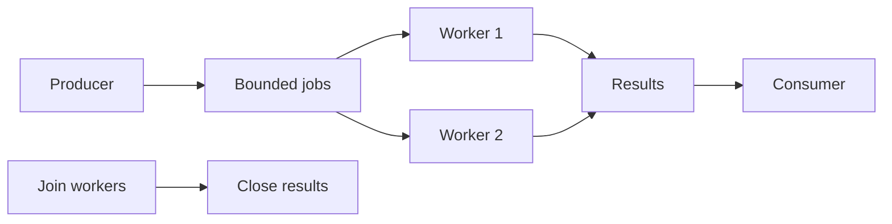

# 09 · Worker pools y shutdown

[Índice del módulo](README.md) · [Roadmap](../../ROADMAP.md) · Anterior: [Context y cancelación](08-context.md) · Siguiente: [TCP y HTTP](../06-backend/01-protocols.md)

## Objetivos de aprendizaje

- Explicar worker pools y shutdown y el problema que resuelve.
- Predecir el comportamiento del ejemplo, incluyendo sus límites.
- Aplicar el contrato del ejercicio y justificar una decisión sin copiar el ejemplo.

## Conocimientos previos

Estudia [Context y cancelación](08-context.md) antes. El recorrido es acumulativo: usa el [glosario](../../GLOSSARY.md) si un término de módulos anteriores no está claro. Para comprobar el entorno consulta [setup](../../docs/setup.md).

## Motivación

Necesitas limitar actividades activas y cerrar el sistema sin perder control de quién produce, consume y termina.

## Explicación conceptual

Un worker pool tiene un número acotado de consumidores de una cola. El número de workers limita trabajo activo; la capacidad de cola limita trabajo en espera. Ambos valores son decisiones de presupuesto, no simples parámetros de velocidad. Define bloquear o rechazar cuando la cola está llena.

El coordinador cierra jobs cuando todos los productores terminaron. Los workers salen al drenar un channel cerrado o al cancelar según política. Un WaitGroup puede esperar workers y después cerrar results: así no queda un envío posible sobre canal cerrado. El consumidor debe drenar resultados o permitir cancelación de sus productores.

Graceful shutdown tiene etapas: parar admisión, terminar o drenar lo aceptado dentro de un plazo, cancelar lo restante y esperar salida. Si una tarea ignora context no puedes garantizarla solo con un deadline. Define qué estado tienen los trabajos no ejecutados y cuándo devuelves fallo.

El ejemplo transforma letras con un lote finito; no implementa el sistema final. Usa el patrón de coordinación para razonar, pero el proyecto exigirá estados, reintentos y una API que debes diseñar. No combines todos esos requisitos en un supuesto ejemplo didáctico.

## Modelo mental visual

```text
producer → bounded jobs → worker 1 ─┐
                          worker 2 ─┼→ results → consumer
coordinator: join workers → close results
```

Mermaid complementario (el esquema ASCII anterior contiene la misma coordinación esencial):



El diagrama representa relaciones y decisiones observables, no direcciones reales ni un ABI garantizado. Predice un cambio y dibuja qué parte del modelo cambia.

## Sintaxis y ejemplos

[Programa completo](examples/09-workers/main.go):

```go
package main

import (
	"fmt"
	"sort"
	"strings"
	"sync"
)

func upperBatch(input []string) []string {
	jobs := make(chan string, 2)
	results := make(chan string)
	var wg sync.WaitGroup
	for range 2 {
		wg.Go(func() {
			for s := range jobs {
				results <- strings.ToUpper(s)
			}
		})
	}
	go func() {
		defer close(jobs)
		for _, s := range input {
			jobs <- s
		}
	}()
	go func() { wg.Wait(); close(results) }()
	out := []string{}
	for s := range results {
		out = append(out, s)
	}
	sort.Strings(out)
	return out
}
func main() { fmt.Println(upperBatch([]string{"b", "a", "c"})) }
```

Desde la raíz:

```sh
go run ./modules/05-concurrency/examples/09-workers
go build -o /tmp/go-from-zero-example ./modules/05-concurrency/examples/09-workers
```

**Resultado e interpretación:** Imprime `[A B C]`; ordenar resultados es una decisión para salida estable, no una garantía de orden del pool.

Antes de ejecutarlo, anota tu predicción. Después señala qué instrucción explica cada resultado y qué propiedad no demuestra esta ejecución.

### Prueba completa del ejemplo

El test usa el mismo problema didáctico, no resuelve tus ejercicios. [Source del test](examples/09-workers/main_test.go):

```go
package main

import (
	"reflect"
	"testing"
)

func TestUpperBatch(t *testing.T) {
	got := upperBatch([]string{"z", "a"})
	if !reflect.DeepEqual(got, []string{"A", "Z"}) {
		t.Fatalf("got %v", got)
	}
	if got := upperBatch(nil); len(got) != 0 {
		t.Fatalf("empty got %v", got)
	}
}
```

### Verificación específica

Desde la raíz del repo:

```sh
go test -race -count=1 ./modules/05-concurrency/examples/09-workers
```

## Comparación con otros lenguajes

Workers en Redis añaden durabilidad y distribución; un channel solo coordina este proceso. Los mecanismos no ofrecen las mismas garantías.

## Errores comunes

Cerrar results antes del join; workers infinitos sin salida; pool que admite cola ilimitada; shutdown sin presupuesto.

Si observas un fallo, conserva el mensaje exacto y una hipótesis. Compilar y ejecutar son verificaciones diferentes; no arregles por ensayo ciego.

## Ejercicio guiado

Implementa un pool que cuente runes de un lote finito de strings con máximo dos workers. Entrada:["ñ","abc"]. Salida:multiconjunto {1,3}. Restricción: productor cierra jobs, coordinador cierra results después de join. Aceptación: todos los resultados una vez y -race limpio.

[Enunciado y espacio de implementación](exercises/09-workers/guided/README.md) · [Pistas progresivas](exercises/09-workers/guided/HINTS.md). Escribe tú la implementación; no hay solución preparada.

## Desafío independiente

Extiende tu pool con ctx y prueba consumidor que cancela antes de consumir todo. Entrada:lote largo. Salida:todos los workers terminan. Restricción: cada envío debe poder cancelar. Aceptación: test con deadline y espera explícita, sin solución del proyecto final.

[Enunciado y espacio](exercises/09-workers/challenge/README.md) · [Pistas opcionales](exercises/09-workers/challenge/HINTS.md). Resuelve primero sin abrir pistas.

## Preguntas de comprensión

1. ¿Por qué cerrar results después de Wait?
2. ¿Qué dos límites necesitas?

[Respuestas razonadas](self-assessment/09-workers.md): consulta después de responder y explica en tus palabras cualquier diferencia. No contienen soluciones de ejercicios.

## Resumen y referencias

Necesitas limitar actividades activas y cerrar el sistema sin perder control de quién produce, consume y termina. El criterio de comprensión es explicar el mecanismo, predecir el ejemplo y justificar sus límites.

[Pipelines](https://go.dev/blog/pipelines) · [HTTP Shutdown](https://pkg.go.dev/net/http#Server.Shutdown)

[Compatibilidad y fuentes](../../docs/sources.md) · [Registrar evidencia](../../PROGRESS.md)
